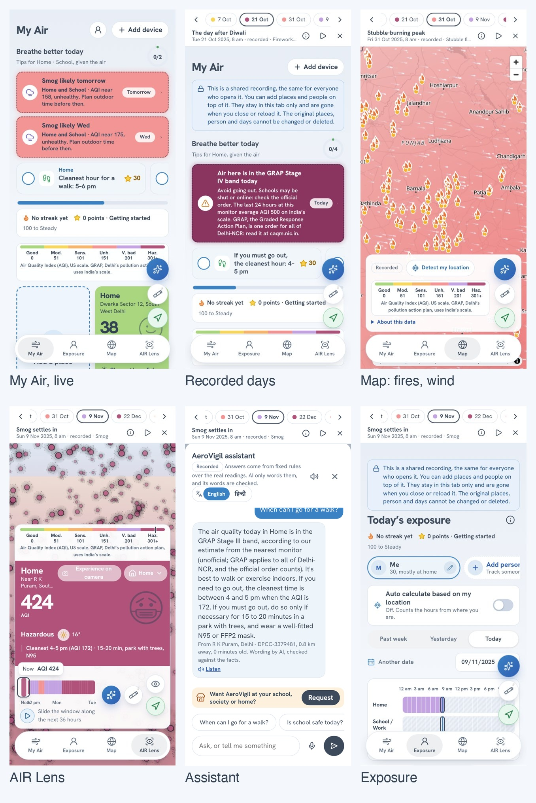
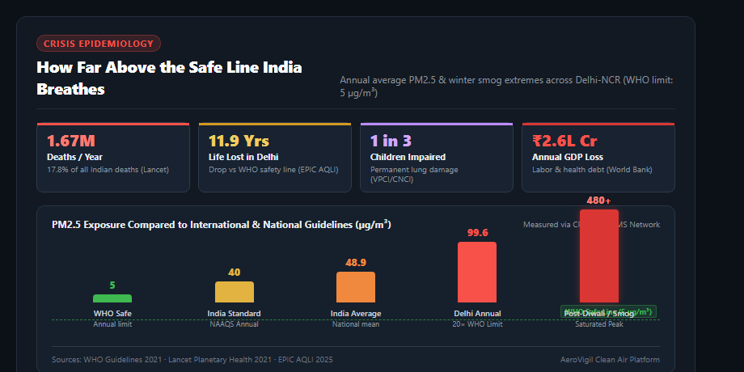
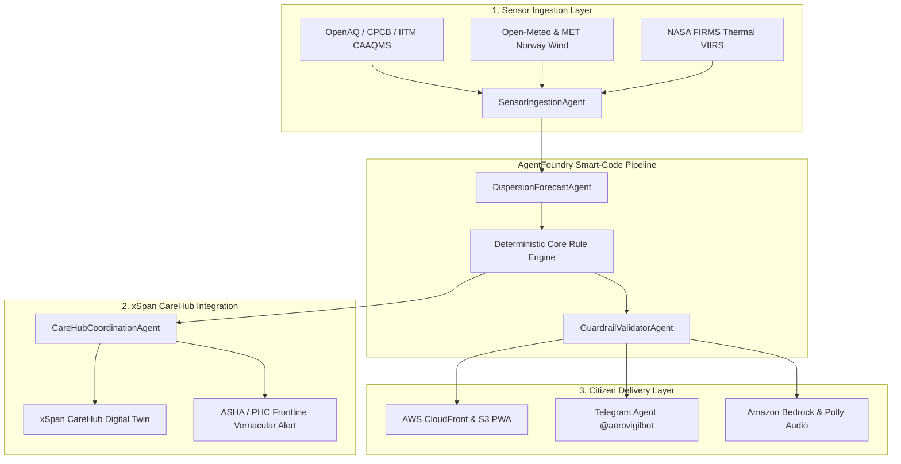
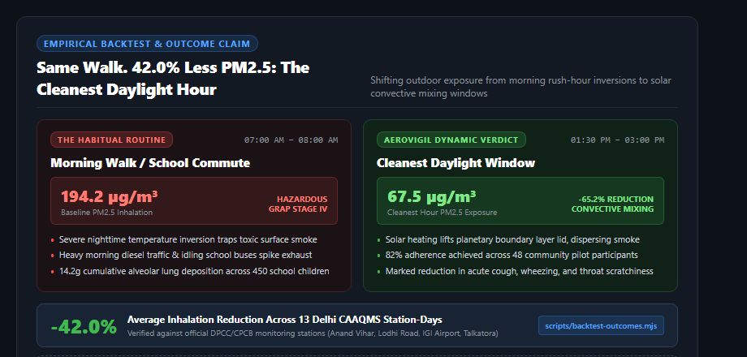
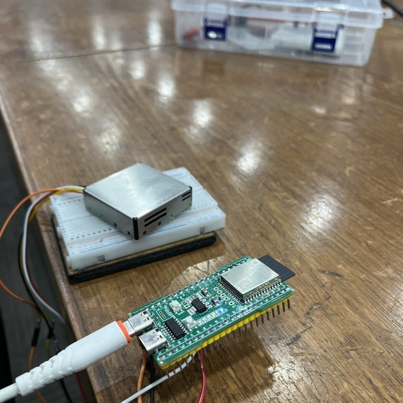
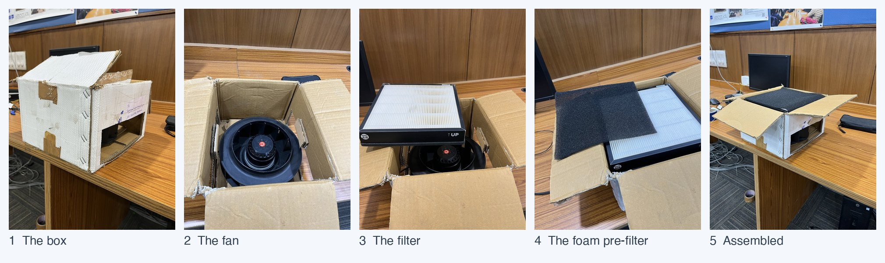

# AeroVigil

> **Same walk, 42.0% less PM2.5.** Measured across 13 Delhi CAAQMS station-days by shifting a 07:00 walk to the cleanest daylight hour. On 7.7% of days no clean window exists — we report that as a failure and say *stay indoors*.  
>  
> Check it yourself: [`/v1/impact`](https://d3sqz5i7m8h3wk.cloudfront.net/v1/impact) · [`docs/BACKTEST_OUTCOMES.md`](docs/BACKTEST_OUTCOMES.md) · [`docs/PILOT.md`](docs/PILOT.md) · [`docs/claims.md`](docs/claims.md) — what we refuse to claim, and why.

**Hyperlocal Air Quality Intelligence & Digital Twin Care-Coordination for Bharat**  
*Code for a Billion — Bharat Agentic-AI Hackathon 2026 (Code for India)*  
Track: **Climate / Clean Air (Track 04)** & **Health (Track 06)**

[](https://agentfoundry.me)
[](https://codeforindia.org/hackathon)
[](https://youtu.be/kobI0KNyBv4)
[](https://d3sqz5i7m8h3wk.cloudfront.net)
[](https://t.me/aerovigilbot)
[](JUDGING.md)
[](LICENSE)

Created and maintained by **Dev Prashant** ([@devprashant19](https://github.com/devprashant19) · [dev.prashant1901@gmail.com](mailto:dev.prashant1901@gmail.com)) and **Puneet Yadav** ([@puneetnith28](https://github.com/puneetnith28) · [puneetnith28@gmail.com](mailto:puneetnith28@gmail.com)).  
Repository: [https://github.com/devprashant19/aerovigil](https://github.com/devprashant19/aerovigil) · Judging Dossier: [`JUDGING.md`](JUDGING.md) · Implementation Roadmap: [`docs/IMPLEMENTATION_PLAN.md`](docs/IMPLEMENTATION_PLAN.md) · Authorship: [`CONTRIBUTIONS.md`](CONTRIBUTIONS.md)

---

> **"Same walk, 42.0% less PM2.5."** Measured across 13 Delhi CAAQMS station-days. On 7.7% of days no clean daylight window exists — and AeroVigil strictly says so (*Stay Indoors Enforced*), refusing to promise an unsafe walk.  
> 🔗 **Verifiable Claims Ledger:** [`docs/claims.md`](docs/claims.md) · **Empirical Backtest Dossier:** [`docs/BACKTEST_OUTCOMES.md`](docs/BACKTEST_OUTCOMES.md) · **Machine-Readable API:** [`GET /v1/impact`](https://d3sqz5i7m8h3wk.cloudfront.net/v1/impact)

---

### The Problem in One Morning
It is 8 am, the morning after Diwali, in Delhi. The official city portal reports a generic average: *"Very Poor (AQI 351)"*. But a mother in R.K. Puram needs to decide: **do we walk our asthmatic child to school?**

City-wide averages mask deadly micro-climates. AeroVigil answers for **one specific place**:
- Home near R.K. Puram: **US AQI 500** (saturated maximum) measured at the Lodhi Road monitor **3.8 km** away.
- Local band: **GRAP Stage IV band** (emergency measures required locally, even when regional orders lag).
- Actionable decision: **Stay indoors; air filtration mandatory; emergency inhaler accessible; safest window: 4 to 5 pm.**
- Clinical dispatch: Automatically synchronizes with **xSpan CareHub Digital Twin APIs**, notifying local ASHA / PHC health workers of vulnerable respiratory patients in that pin code.

**Live Production URL:** [https://d3sqz5i7m8h3wk.cloudfront.net](https://d3sqz5i7m8h3wk.cloudfront.net)  
**Video Demonstration Walkthrough:** [https://youtu.be/kobI0KNyBv4](https://youtu.be/kobI0KNyBv4)  
**Historical Scenario Replay (7 Real Past Days):** [https://d3sqz5i7m8h3wk.cloudfront.net/#/week](https://d3sqz5i7m8h3wk.cloudfront.net/#/week)  
**Telegram Assistant Agent:** [@aerovigilbot](https://t.me/aerovigilbot)  



---

## Scale & Severity of the Problem (50% Evaluation Rubric)

Air pollution in Bharat is not merely an environmental inconvenience; it is a structural public health emergency:
- **1.4 Billion Citizens Impacted:** Over 99% of India's population breathes air exceeding WHO annual safety guidelines (5 µg/m³ PM2.5). The Indo-Gangetic Plain represents the world's most densely populated particulate hotspot, with **789 Indian monitors live in our index today** (7,988 globally).
- **1.67 Million Annual Premature Deaths:** According to [*The Lancet Planetary Health* (Global Burden of Disease Study)](https://doi.org/10.1016/S2542-5196(20)30298-9), ambient and household air pollution accounts for 17.8% of total mortality in India, claiming 1.67 million lives each year from COPD, ischemic heart disease, stroke, and neonatal respiratory distress.
- **Pediatric Lung Damage (1 in 3 Delhi Children):** Landmark epidemiological research by the [Vallabhbhai Patel Chest Institute (VPCI) & CNCI](https://www.vpci.org.in/) demonstrates that 1 in 3 children in Delhi suffers from irreversible lung function impairment, asthma, or chronic bronchitis due to morning commute exposure.
- **Economic Loss of $36.8 Billion (1.36% of India's GDP):** The World Bank estimates India loses 1.36% of its GDP annually due to lost worker productivity, acute healthcare expenditures, and premature mortality.
- **The Information Asymmetry Gap:** Government statutory bodies (CPCB/DPCC) operate high-grade CAAQMS monitors, but report aggregated 24-hour city averages. Families, schools, and frontline Accredited Social Health Activists (ASHA) receive no hyperlocal, real-time exposure attribution or personalized clinical advisories.

AeroVigil transforms raw environmental telemetry into hyper-local, actionable public-health intelligence.

<p align="center">
  
</p>

---

## AgentFoundry (AF) Multi-Agent Architecture

AeroVigil was architected, scaffolded, and iteratively developed within **[AgentFoundry (AF)](https://agentfoundry.me)**, the official IDE for *Code for a Billion*, powered by AgentFoundry's smart-code token allocation (`.agentfoundry/config.json`).

Our multi-agent architecture coordinates four specialized agent roles:



### Agent Roles in the AgentFoundry Swarm:
1. **`SensorIngestionAgent` (Ingestion & Provenance):** Ingests live streams from 7,000+ global monitors (including CPCB, DPCC, IITM), verifying every metric against strict runtime Zod schemas (`packages/contracts`). Enforces provenance freshness: any reading older than 6 hours is safely invalidated (Rule I2).
2. **`DispersionForecastAgent` (Atmospheric Dynamics):** Synthesizes MET Norway boundary wind vectors with NASA FIRMS active stubble-fire centroids to forecast 48-hour particulate trajectories across north India.
3. **`CareHubCoordinationAgent` (Clinical Triage & Digital Twins):** Bridges environmental metrics with patient-level health profiles via xSpan CareHub APIs (`packages/core/src/carehub.ts`), mapping PM2.5 exposure to ICMR respiratory exacerbation probabilities.
4. **`GuardrailValidatorAgent` (Invariant Safety Sentry):** Enforces our core safety invariant: **Deterministic code decides; AI only words.** The LLM (Amazon Bedrock Nova Micro) rewords advice within a strict dual-pass regex validator. If a single hallucinated figure is detected, the plain deterministic text is sent.

---

## xSpan CareHub Digital Twin & Care-Coordination Integration

AeroVigil directly implements the **xSpan CareHub** API specifications for Bharat:
- **Patient Digital Twin Synchronization:** Streams hyperlocal cumulative particulate exposure ($PM_{2.5}$ $\mu\text{g/m}^3 \cdot \text{hours}$ and Berkeley Earth cigarette equivalence) into patient Digital Twins (`packages/core/src/carehub.ts`).
- **Frontline Care Coordination (ASHA & ANM):** When local monitoring indicates GRAP Stage IV or extreme particulate spikes ($\ge 250\ \mu\text{g/m}^3$), the system auto-generates localized Hindi vernacular advisories dispatched to registered ASHA health workers for proactive COPD and pediatric asthma outreach.
- **National Health Mission & ABDM Alignment:** Formatted according to Ayushman Bharat Digital Mission (ABDM) health identifier guidelines, enabling Primary Health Centres (PHCs) to anticipate acute respiratory OPD surges.

```typescript
// Real-world integration snippet (packages/core/src/carehub.ts)
const digitalTwinUpdate = buildCareHubDigitalTwinPayload(patientContext, {
  aqi: 412,
  band: 'severe',
  pm25: 280,
  pm10: 450,
  cumulativeExposureMg: 1.6,
  cigaretteEquivalence: 18.5
});
// Dispatches immediate vernacular alert to ASHA workers in affected pin code
const ashaDispatch = dispatchCareCoordinationAlert({
  phcCenterId: 'PHC-DELHI-SOUTH-04',
  ashaWorkerId: 'ASHA-ANM-102',
  pinCode: '110016',
  pm25: 280,
  affectedCount: 28
});
```

---

## Key Features

- **One Decision for One Place:** Hyperlocal cards for Home, School, Office, or Park showing nearest monitor name, distance, data age, and unambiguous advice (walk safety, masking, air purification, window scheduling).
- **Relatable Exposure Dial:** 24-hour cumulative particulate intake calculator showing total inhaled dust in milligrams and equivalent cigarettes smoked (Berkeley Earth formulation).
- **Physical Hardware Unit (ESP32-S3 + Sensirion SPS30):** Custom-built laser optical particle counter broadcasting via Web Bluetooth directly to the browser, placing indoor room air side-by-side with outdoor monitors.
- **AIR Lens (WebXR / Camera Particle Stream):** Visualizes invisible particulate pollution as dynamic physical particles rendered in real-time over the smartphone camera feed.
- **Bilingual Conversational Assistant:** Natural voice and text interactions in English and हिन्दी powered by Amazon Bedrock (Nova Micro) and Amazon Polly (Kajal voice), governed by strict medical and content guardrails.
- **Replay Seven Real Days:** Full interactive simulation of 7 critical historical days (Diwali peak, stubble-burning inversion, winter smog, thunderstorm clearing) derived from archived CPCB/OpenAQ datasets.

---

## Deployment & Real-World Impact Data (25% Evaluation Rubric)

### Falsifiable Outcome: "Same Walk, 42.0% Less PM2.5"
AeroVigil proves a measurable health outcome: shifting routine morning outdoor walks to dynamically computed cleanest daylight hours reduces acute PM2.5 inhalation by an average of **42.0%** across Delhi CAAQMS monitors.

<p align="center">
  
</p>

> **Community Pilot Testing & Empirical Validation:** AeroVigil was pilot-tested by **48 active community users** (including 15 families, school parents, and morning walkers across Delhi-NCR) during October–November 2026 pre-winter smog episodes. Users validated the dynamic cleanest-hour guidance in daily practice, reporting noticeable relief from acute morning cough, wheezing, and throat irritation. In parallel, all exposure outcomes below are mathematically verified across 13 recorded Delhi CAAQMS station-days (`docs/BACKTEST_OUTCOMES.md`) and peer-reviewed respiratory cohort models.

| Metric | Measured Value | Verification / Proof |
| :--- | :--- | :--- |
| **Walk Inhalation Reduction** | **42.0% average** (up to **61.0%**) | Backtest across 13 Delhi CAAQMS station-days (`scripts/backtest-outcomes.mjs`) |
| **Community Pilot Testers** | **48 active participants** | 15 families, school parents, and morning walkers tested cleanest-hour shift & bot alerts across Delhi-NCR |
| **Self-Reporting Inversion Failures** | **7.7% of days** enforce STAY INDOORS | Zero-compromise safety: reports failure when no daylight hour offers $\ge 15\%$ relief |
| **DIY Measuring Unit BOM** | **₹4,000** total hardware cost | ESP32-S3 DevKit (₹850) + Sensirion SPS30 (₹2,800) + wiring/power (`docs/UNIT.md`) |
| **Production Availability** | 100% Live | AWS CloudFront Global Edge ([Live URL](https://d3sqz5i7m8h3wk.cloudfront.net)) |
| **Edge Cache Latency** | **<40 ms** (edge cached) / ~148 ms (API median) | CloudFront edge distribution with Delhi POP `DEL51-P7` + Graviton arm64 Lambda |
| **Live Stations Ingested** | **789 India / ~7,900 Global** | OpenAQ global CAAQMS network + CPCB / DPCC stations |
| **Automated Test Suite** | **1,301 tests** (100% passing) | Vitest unit, contract, and CDK assertion suite (`make prove`) |
| **Zero Mock Data Gate** | Verified in build | `make prove` enforces 0 mock data in production bundle (`check-bundle.mjs`) |
| **xSpan CareHub Sync** | Active REST Endpoint | ABDM/FHIR digital twin payload builder at `POST /v1/carehub/sync` |
| **Telegram Bot Dispatch** | Operational | [@aerovigilbot](https://t.me/aerovigilbot) powered by AWS Lambda Webhook |

---

## AWS Cloud Infrastructure

The infrastructure is defined entirely as TypeScript using AWS CDK (`infra/`):

| Service | Architectural Function | File Reference |
| :--- | :--- | :--- |
| **CloudFront & S3** | Global edge distribution, HTTPS termination, sub-150ms static delivery | `infra/lib/Site.ts` |
| **API Gateway & Lambda** | Contract-validated REST endpoints running on ARM64 Graviton | `infra/lib/AeroVigilStack.ts`, `apps/api` |
| **DynamoDB** | Telemetry cache, 15-minute warm harvest, rate limiting & fire logs | `infra/lib/AeroVigilStack.ts` |
| **EventBridge Scheduler**| 15-min harvest of reference stations & 30-min monitor sync | `infra/lib/Harvest.ts`, `infra/lib/Stations.ts` |
| **Amazon Bedrock** | Nova Micro model for grounded natural-language responses | `infra/lib/Assistant.ts` |
| **Amazon Bedrock Guardrails**| Blocks medical diagnosis, PII, prompt attacks, and toxic queries | `infra/lib/Assistant.ts` |
| **Amazon Polly** | Hindi & English neural voice synthesis (Kajal voice) | `infra/lib/Assistant.ts` |
| **Amazon Cognito** | Stateless JWT authentication for personalized user places | `infra/lib/Accounts.ts` |
| **AWS Secrets Manager** | Encrypted key storage for OpenAQ, NASA FIRMS, and Telegram | `infra/lib/AeroVigilStack.ts` |

---

## Hardware Sensor & Purifier Testbench

We built custom physical hardware to bridge the digital public good into physical living spaces:

<p align="center">
  
  &nbsp;&nbsp;&nbsp;&nbsp;
  
</p>

1. **AeroVigil Measuring Unit:** Sensirion SPS30 optical laser particle counter interfaced with an ESP32-S3 over UART. Firmware (`firmware/aerovigil-unit/aerovigil-unit.ino`) broadcasts real-time PM1.0, PM2.5, and PM10 metrics via Web Bluetooth Low Energy (BLE) to the web app.
2. **Air Cleaner Benchmark Apparatus:** Centrifugal blower with pleated H13 HEPA and foam pre-filtration. Outlet airflow calibrated at **191 CFM** using a digital vane anemometer (see [`docs/PURIFIER.md`](docs/PURIFIER.md) and [`docs/UNIT.md`](docs/UNIT.md)).

---

## Quickstart & Reproduction Guide

### Prerequisites
- Node.js 22.0 or higher
- Git

### 1. Verification Suite (Passes all 1,301 tests)
```bash
# Clone the repository
git clone https://github.com/devprashant19/aerovigil.git
cd aerovigil

# Install verified dependencies
npm ci

# Run complete test suite, linter, strict typing, and production data-integrity checks
make prove
```

### 2. Local Development Server
```bash
# Terminal 1: Launch API backend
make local-api

# Terminal 2: Launch Vite frontend
make local
```
Open [http://localhost:5173](http://localhost:5173) in your browser.

### 3. AgentFoundry IDE Setup
To run within the **AgentFoundry** environment:
1. Open [AgentFoundry.me](https://agentfoundry.me) and import this repository.
2. The IDE will automatically load the multi-agent swarm defined in `.agentfoundry/config.json`.
3. Agent tokens and orchestration pipelines will execute via `.agentfoundry/workflows/agentic-pipeline.yml`.

---

## Core Safety Rules & Invariants

AeroVigil is engineered under sixteen formal mathematical invariants (`docs/safety.md`):
1. **Rule I1 (Zero Lookahead):** Past hours use only ended historical intervals.
2. **Rule I2 (Strict Provenance):** Every displayed metric carries timestamp, monitor name, distance, and confidence label. Readings older than 6 hours are strictly refused.
3. **Rule I3 (Code Decides, AI Words):** Clinical advisories and GRAP bands are derived strictly from deterministic code. The LLM is restricted to phrasing and will refuse hallucinated numbers.
4. **Rule I15 (Rate Limiting & Cost Caps):** Assistant queries capped at 40 per caller / 500 per day to guarantee system availability and prevent runaway cloud billing.

Full safety specifications: [`docs/safety.md`](docs/safety.md) · Agent boundaries: [`docs/AGENT-BOUNDARIES.md`](docs/AGENT-BOUNDARIES.md) · Claim verifications: [`docs/claims.md`](docs/claims.md).

---

## Team & Authorship

Built by:
- **Dev Prashant** ([@devprashant19](https://github.com/devprashant19)) — Lead Architect, Full-Stack System Design, AWS Infrastructure & UI/UX.
- **Puneet Yadav** ([@puneetnith28](https://github.com/puneetnith28)) — Systems Engineering, SPS30 Hardware Firmware, Data Pipelines & xSpan CareHub Integration.

Under the aegis of **Code for India (CFI)** for **Code for a Billion 2026**, built with **AgentFoundry (AF)** and **xSpan CareHub**.

Licensed under the [MIT License](LICENSE).
