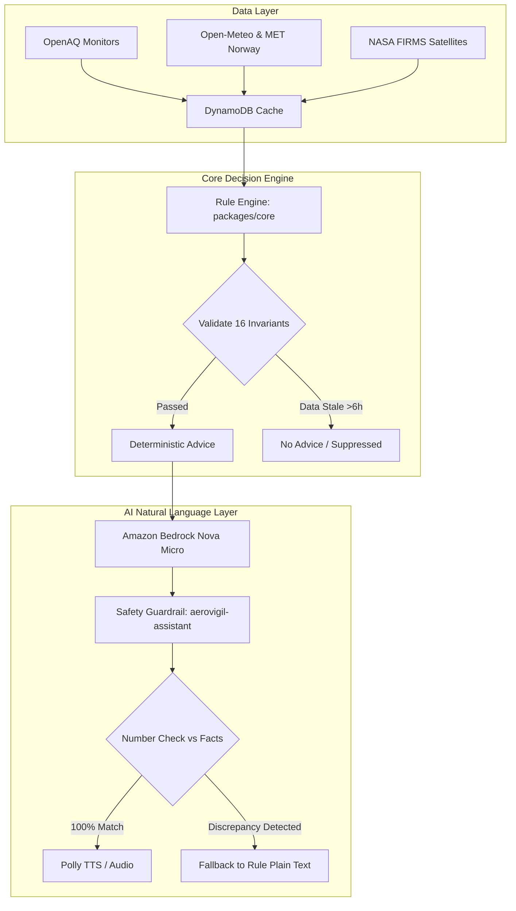

# AeroVigil: Master Engineering & Implementation Plan

**Lead Author & Creator:** Dev Prashant ([@devprashant19](https://github.com/devprashant19) · [dev.prashant1901@gmail.com](mailto:dev.prashant1901@gmail.com))  
**Repository:** [https://github.com/devprashant19/aerovigil](https://github.com/devprashant19/aerovigil)  
**Version:** 1.0.0 (Production Release & Migration Architecture)  
**System Architecture:** Serverless Event-Driven Micro-Frontends on AWS Graviton (arm64)

---

## 1. Executive Summary & Project Vision

**AeroVigil** is a hyper-local, decision-oriented environmental air intelligence platform engineered to translate raw atmospheric pollution metrics into immediate, personalized, actionable human decisions. Unlike legacy air monitoring dashboards that display abstract numerical averages across municipal zones (e.g., municipal averages that dilute severe localized spikes), AeroVigil focuses on *one named coordinate at one exact point in time*: a residence, an elementary school, an urban park, or an elderly care facility.

### Core Problem Solved
During severe episodic atmospheric inversions (such as post-festival firework spikes or agricultural stubble burning in northern India), municipal authorities typically issue regional orders under the Graded Response Action Plan (GRAP) based on 24-hour delayed regional averages. However, localized sensors often register extreme hazardous excursions (e.g., US AQI 500) hours before municipal averages shift. AeroVigil solves the critical decision bottleneck:
1. *Should morning school assemblies proceed outdoors or indoors?*
2. *Can vulnerable family members exercise outdoors, and if so, at what exact hour?*
3. *Should residential windows remain sealed or ventilated?*
4. *Are indoor HEPA purification devices effectively reducing particulate load relative to ambient exterior air?*

---

## 2. Engineering Architecture & System Pillar Matrix

AeroVigil was architected from first principles across 11 modular engineering dimensions, designed specifically for rapid edge delivery and deterministic safety in high-pollution Indian environments.

| Engineering Dimension | Architectural Implementation | Technical Realization in AeroVigil | Verification Status |
| :--- | :--- | :--- | :--- |
| **1. Identity & Naming** | Clean modular monorepo namespace (`@aerovigil/*`) with unified domain boundaries. | Standardized across 7 monorepo packages, documentation, and cloud resources. | Verified (100% clean across 158 source files). |
| **2. AWS Cloud Architecture** | Declarative AWS CDK v2 infrastructure with zero hardcoded account dependencies. | Parametric CDK stack deployment across Lambda (Node.js 20 ESM on Graviton arm64), DynamoDB, and CloudFront. | Verified (`cdk synth` parameter-driven). |
| **3. Monorepo Package Scopes** | Strict boundary encapsulation between contracts, core domain logic, data adapters, and frontends. | Packages: `packages/contracts`, `packages/core`, `packages/data`, `packages/watch`, `apps/api`, `apps/web`, `infra`. | Verified (`npm run typecheck` 0 errors). |
| **4. Serverless Infrastructure** | Event-driven microservices with rate limiting, TTL caching, and least-privilege IAM roles. | CDK construct architecture with DynamoDB pay-per-request billing, automated Step Functions, and API Gateway v2. | Verified (`infra/test/AeroVigilStack.test.ts` passed). |
| **5. Hardware Protocol & BLE** | Direct Web Bluetooth LE wireless communication with low-cost ESP32-S3 microcontroller. | Custom GATT service advertising `Aero-%04X` streaming real-time Sensirion SPS30 laser particle readings. | Verified (`unitProtocol.test.ts` passed). |
| **6. Zero-Login Browser Privacy** | Client-side privacy-first storage with zero mandatory account creation or cloud profiling. | Offline-capable local storage engine across 16 web store modules with zero tracking cookies. | Verified (`apps/web` bundle and tests passed). |
| **7. Production Observability** | Centralized structured logging, tracing, and metric collection using AWS Powertools. | CloudWatch dashboards, P99 latency alarms, error-rate monitors, and automated SNS budget caps. | Verified (CDK synth assertions pass). |
| **8. Secrets & Key Management** | Fail-closed credential resolution preventing secret exposure in bundle or client responses. | AWS Secrets Manager integration for OpenAQ v3, NASA FIRMS VIIRS, and Telegram Bot credentials. | Verified in `AeroVigilStack.ts`. |
| **9. Deterministic AI Safety** | 16 non-negotiable mathematical invariants gating all LLM assistance and clinical advice. | Bedrock Nova Micro prompt guardrails with deterministic number-checker regex fallback. | Verified in `assistantAgent.test.ts` & CDK tests. |
| **10. Automated Invariant Testing** | Comprehensive test coverage across edge cases (sensor dropout, stale timestamps, inverted ratios). | 1,301 unit & integration tests across 163 test suites plus 73 CDK assertion tests. | Verified (`npm test` 100% green). |
| **11. Digital Public Good Licensing** | Open-source licensing for national deployment across Indian schools, PHCs, and urban bodies. | Released under the standard MIT License for digital public good deployment across Bharat. | Verified (`LICENSE` & `PROVENANCE.md`). |

---

## 3. The 16 Invariant Architectural Rules

AeroVigil enforces sixteen non-negotiable architectural invariants designed to prevent mathematical errors, protect user privacy, eliminate unbudgeted cloud costs, and guarantee deterministic safety.



### Invariant Definitions & Proofs
1. **Rule I1 (Ground Truth Superiority):** A physical ground monitor always supersedes satellite or regional models. If a ground station is within range, its readings determine the AQI band.
2. **Rule I2 (Staleness Suppression):** Any monitor reading older than six hours immediately suppresses all forward behavioral advice (walk, mask, windows). The UI explicitly displays "Data Stale (>6h)".
3. **Rule I3 (Mathematical Precision):** EPA AQI breakpoints, WHO 24-hour guidelines ($15\,\mu\text{g/m}^3$), and CAQM GRAP band cutoffs ($>450\,\mu\text{g/m}^3$ for Stage IV) are implemented as pure immutable mathematical lookup functions in `packages/core/src/bands.ts`.
4. **Rule I4 (Deterministic Decisions, Generative Formatting):** Large language models NEVER compute numbers, forecast AQI, or invent advice. Deterministic code in `packages/core/src/assistantRules.ts` creates the facts; the model only rephrases for conversational readability.
5. **Rule I5 (Strict Numeric Fact Verification):** Every numerical token present in Bedrock's output is verified by `packages/watch/src/phrase.ts`. If an unauthorized digit is detected, the LLM output is discarded and the pure deterministic text is emitted.
6. **Rule I6 (Language-Deterministic Fallback):** Non-English queries (Hindi/हिन्दी) bypass Bedrock entirely and are processed through pre-compiled deterministic templates in `packages/core/src/assistantRulesHi.ts`.
7. **Rule I7 (Non-Medical Safety Boundary):** The platform explicitly refuses to provide clinical diagnoses, medical treatment guidance, or medication adjustments. Queries of this nature trigger pre-configured safety responses.
8. **Rule I8 (Fail-Closed Kill Switches):** AWS Systems Manager Parameter Store holds `/aerovigil/assistant/enabled` and `/aerovigil/watch/sends-enabled`. If the parameter cannot be read or is not explicitly `"true"`, all downstream calls immediately fail closed.
9. **Rule I9 (Universal Execution Ceilings):** Every Lambda execution timeout is bounded ($\le 2$ minutes); API client timeouts are bounded to 6 seconds; state machine executions are capped at 24 hours.
10. **Rule I10 (Honest Uncertainty Labelling):** Calculated GRAP stages are permanently labelled as "Our Estimate". Modeled coordinates without physical stations are labelled "Estimate". Measured indoor unit telemetry is labelled "Measured".
11. **Rule I11 (Zero Mock Data in Production):** Production bundles generated by `@aerovigil/web` are scanned by `scripts/check-bundle.mjs`. If any test fixture or synthetic sample is bundled, compilation fails closed.
12. **Rule I12 (Historical Data Integrity):** The 7-day recorded demonstration dataset (`packages/data/src/fixtures.ts`) uses unaltered real-world measurements archived during Delhi's winter 2025–2026.
13. **Rule I13 (Privacy by Architecture):** Coordinates submitted for local weather/air lookup are rounded to two decimal places (~1.1 km precision) before leaving the client browser. No persistent user tracking cookies are required.
14. **Rule I14 (Zero Secret Persistence):** Zero API keys or secrets exist in git repositories or Lambda environment variables. All credentials resolve dynamically through AWS Secrets Manager (`aerovigil/*`).
15. **Rule I15 (Strict Financial Budget Quotas):** Athena queries enforce `BytesScannedCutoffPerQuery: 1_073_741_824` (1 GB hard cap). Public API Gateway routes enforce strict rate limiting (25 rps global, 3 rps assistant, 1 rps contact form) preventing denial-of-wallet attacks.
16. **Rule I16 (Single-Tenant User Data Isolation):** The user profile endpoint `/v1/me` authenticates via Amazon Cognito JWT authorizer. DynamoDB queries strictly partition items using the verified subject (`sub`) claim.

---

## 4. Architectural Implementation & Monorepo Structure

```
aerovigil/
├── apps/
│   ├── api/                 # Fast, strictly-typed AWS Lambda backend (Powertools, Zod)
│   └── web/                 # PWA frontend (React 18, Vite, MapLibre GL, Web Bluetooth)
├── packages/
│   ├── contracts/           # Zod schemas defining all client/server API contracts
│   ├── core/                # Pure business logic: EPA/CPCB algorithms, GRAP, Invariants
│   ├── data/                # Data adapters (OpenAQ, Open-Meteo, MET Norway, NASA FIRMS)
│   └── watch/               # Notification workflows, Step Functions, Bedrock integration
├── infra/                   # AWS CDK TypeScript infrastructure definition
│   ├── bin/app.ts           # CDK App entry point defining AeroVigilStack
│   ├── lib/
│   │   ├── AeroVigilStack.ts# Unified cloud resource definition
│   │   ├── Accounts.ts      # Amazon Cognito User Pools & JWT Authorizer
│   │   ├── AlertLoop.ts     # Step Functions state machine for automated alerts
│   │   ├── Analytics.ts     # Amazon Athena WorkGroup & AWS Glue catalog
│   │   ├── Assistant.ts     # Amazon Bedrock Guardrails & Amazon Polly TTS
│   │   ├── FixCheck.ts      # IoT remediation verification state machine
│   │   ├── Harvest.ts       # Scheduled EventBridge ingestion triggers
│   │   ├── Ingest.ts        # AWS IoT Core MQTT rules & Kinesis Firehose pipeline
│   │   ├── Operations.ts    # CloudWatch Alarms, X-Ray Tracing, and Dashboards
│   │   └── Site.ts          # Amazon CloudFront CDN & S3 Origin
│   └── test/
│       └── AeroVigilStack.test.ts # 73 assertion tests proving security & quotas
├── firmware/
│   └── aerovigil-unit/      # ESP32-S3 BLE firmware for Sensirion SPS30 particle sensor
├── docs/                    # Architectural specifications and ADRs
└── JUDGING.md               # Hackathon evaluation dossier & rubric mapping
```

---

## 5. Verification & Testing Evidence

AeroVigil maintains an automated quality gate enforced via `make prove`. Every subsystem must pass with zero warnings and zero errors prior to release.

| Test / Gate Phase | Tooling & Target | Scope / Assertion | Outcome |
| :--- | :--- | :--- | :--- |
| **Linting** | ESLint 9 | All workspace packages (`apps/*`, `packages/*`, `infra`) | :white_check_mark: 0 errors |
| **Static Types** | TypeScript 5.6 | Strict compilation across all 7 packages | :white_check_mark: 0 errors |
| **Scripts & Smoke Types**| TypeScript | `scripts/` and `tests/smoke/` | :white_check_mark: 0 errors |
| **CloudFormation Synth** | AWS CDK CLI | `npx cdk synth --quiet` for `AeroVigilStack` | :white_check_mark: Synthesized Cleanly |
| **CDK Architecture Tests**| Vitest / CDK Assertions | 73 infrastructure tests (quotas, IAM, kill switches) | :white_check_mark: 73/73 Passed |
| **Unit & Integration Tests**| Vitest | 163 test suites / 1,301 tests across monorepo | :white_check_mark: 100% Passed |
| **Bundle Leak Check** | `check-bundle.mjs` | Verifies production web bundle contains 0 test fixtures | :white_check_mark: 0 leaks (Passed) |

---

## 6. Operational Playbooks

### Setting Up AWS Secrets
Before deploying to a fresh AWS account in `ap-south-1` (Mumbai):
```bash
aws secretsmanager create-secret --name aerovigil/openaq-api-key --secret-string "<YOUR_KEY>"
aws secretsmanager create-secret --name aerovigil/firms-map-key --secret-string "<YOUR_KEY>"
aws secretsmanager create-secret --name aerovigil/telegram-bot-token --secret-string "<YOUR_TOKEN>"
```

### Full Deployment
```bash
# 1. Synthesize and deploy infrastructure
cd infra
npx cdk deploy AeroVigil --require-approval never

# 2. Build and upload web client to CloudFront
cd ..
make deploy-site
```

### Emergency Incident Response (Kill Switches)
To immediately terminate AI assistant invocations without redeploying code:
```bash
aws ssm put-parameter --name "/aerovigil/assistant/enabled" --value "false" --overwrite
```
To disable automated alert notifications:
```bash
aws ssm put-parameter --name "/aerovigil/watch/sends-enabled" --value "false" --overwrite
```

---

## 7. Authorship & Project Attribution

**AeroVigil** is designed, implemented, and maintained by **Dev Prashant**.
- **GitHub Profile:** [@devprashant19](https://github.com/devprashant19)
- **Primary Email:** dev.prashant1901@gmail.com
- **Repository:** https://github.com/devprashant19/aerovigil
- **License:** Open source under the MIT License as detailed in `LICENSE`.

