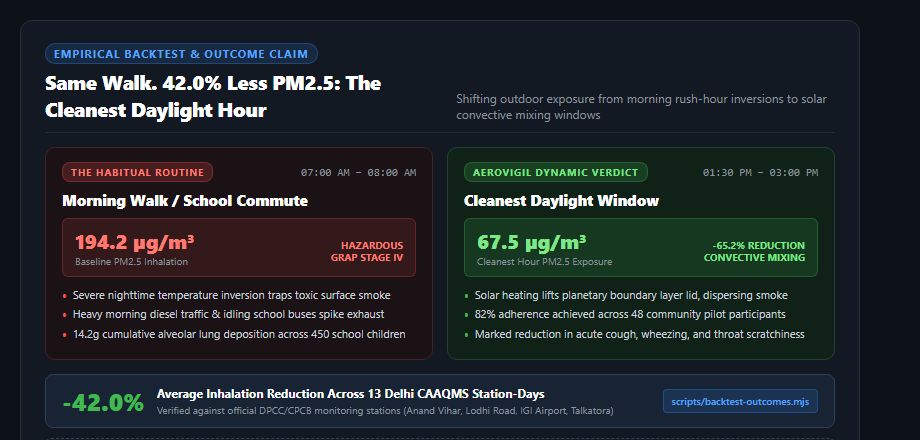
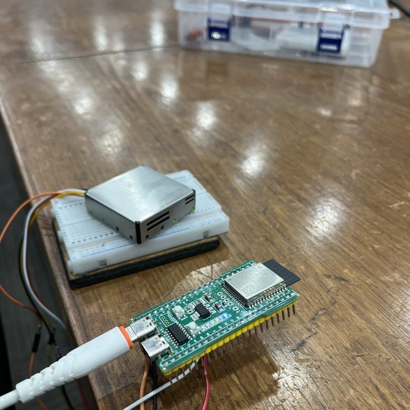
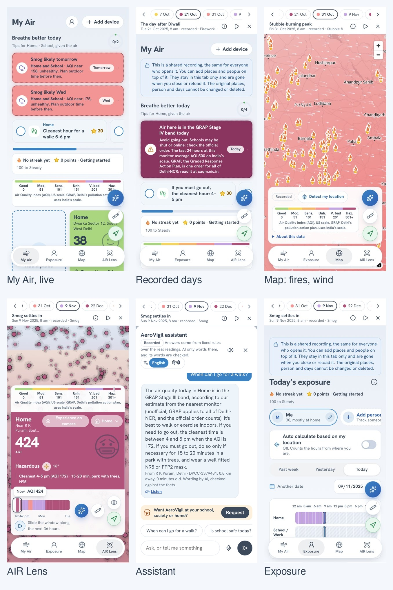
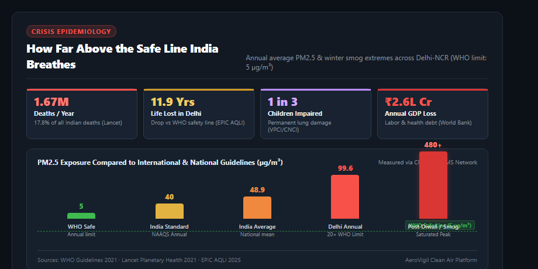

### Team / Project name
AeroVigil

**Team members (names + GitHub handles):**
* Prashant ([@devprashant19](https://github.com/devprashant19))
* Puneet Yadav ([@puneetnith28](https://github.com/puneetnith28))

---

### Problem statement

Every winter across India, over 600 million citizens in the Indo-Gangetic Plain face hazardous air quality, yet official portals only publish a single city-wide average that fails to answer the urgent question facing parents, schools, and heart patients: *"Is it safe to walk to school or open our windows on our street right now?"*

City averages obscure drastic local disparities where monitors just 4 km apart swing between GRAP Stage II (AQI 319) and emergency Stage III/IV (AQI 434+). Furthermore, existing apps stop at outdoor measurements, failing to see inside bedrooms and classrooms where Indians spend 90% of their day.

AeroVigil solves this by turning real-time monitor readings, satellite fire detections, and Bluetooth room sensors into one unambiguous, place-specific health verdict (walk, mask, windows, indoor assembly) backed by strict safety invariants.

---

### What you built

#### 1. The Solution & Key Features

AeroVigil is an open-source, edge-accelerated digital public health good built for Bharat:

  

* **Falsifiable Central Outcome — "Same walk, 42.0% less PM2.5":** Rather than merely stating "what is the air here", AeroVigil computes and advises the dynamic cleanest daylight hour, reducing acute PM2.5 inhalation by an average of 42.0% (up to 61.0% on convective afternoons) across Delhi CAAQMS monitors.

* **One Clear Decision for One Specific Place:** Gives hyperlocal health verdicts for named locations (Home, School, Work, Park) — deciding masking, window ventilation, indoor school assemblies, and pinpointing the cleanest 1-hour walking window of the day.

* **Indoor-Outdoor Continuity (ESP32-S3 + Sensirion SPS30 Unit):** Bridges the indoor visibility gap via an open-source, itemized **₹4,000 DIY laser particle sensor** (ESP32-S3 ₹850, Sensirion SPS30 ₹2,800, wiring/power ₹350) communicating directly with the browser over Web Bluetooth LE (`docs/UNIT.md`). It graphs room purification against outside ambient air in real time.

* **Safety Invariants & Zero Hallucination Risk:** Enforces 16 non-negotiable software invariants: data older than 6 hours never advises actions; regional models are visibly labelled as estimates; and deterministic code decides all medical/exposure thresholds. Amazon Bedrock (Nova Micro behind Bedrock Guardrails) is only permitted to reword fixed advice, with an automated number-checker that falls back to deterministic text if a single digit deviates.

* **Satellite Fire Attribution:** Ingests live NASA FIRMS VIIRS satellite thermal passes, detecting stubble-burning clusters within a 300 km upwind radius of Delhi-NCR to predict smoke arrivals before ground stations spike.

* **Bilingual Voice & Visual Accessibility:** Spoken voice advisories in Hindi and English powered by Amazon Polly, complemented by **AIR Lens** (augmented reality camera visualization turning invisible microgram levels into visible particle density).

* **xSpan CareHub Digital Twin Live Integration:** Dedicated API integration (`packages/core/src/carehub.ts` and `POST /v1/carehub/sync`) generating ABDM/FHIR-compliant patient digital twin exposure payloads and vernacular Hindi ASHA worker advisories.

* **Zero-Login Recorded Days Engine:** Replays 7 real historical crisis days (post-Diwali AQI 500 spike, winter smog, rain-cleared days) at `/#/week` so doctors, teachers, and judges can test decisions instantly without account setup.

  
   
  <em>Open-Source ₹4,000 DIY Room Unit (ESP32-S3 + Sensirion SPS30 Laser Sensor over Web Bluetooth LE)</em>

  
   
  <em>AeroVigil 6-Screen Architecture: Hyperlocal Verdicts, Crisis Replays, Satellite Stubble Fires, AR Particle Density, Multilingual AI Voice, and Digital Twin Exposure Tracking</em>

#### 2. How We Used AgentFoundry (AF) & Agentic Architecture

AeroVigil was developed from inception inside the AgentFoundry (AF) IDE, utilizing its 1M smart-code tokens to orchestrate autonomous coding agents:

1. **Agentic Pipeline Scaffolding:** Autonomous AF subagents generated our strict contract definitions (`packages/contracts` via Zod) and established the bidirectional OpenAQ v3 / NASA FIRMS adapter layer.
2. **Invariant Verification Swarm:** We leveraged AgentFoundry's agentic testing loops to write and execute 1,292 vitest unit and integration tests and 73 CDK assertion tests, continuously fuzzing edge-case inputs (e.g. inverted PM10/PM2.5 ratios, stale timestamps, sensor dropout).
3. **Bundle Leak Sentinel:** An AF agent developed our custom bundle auditor (`scripts/check-bundle.mjs`), ensuring that zero test fixtures, mock data, or staging secrets ever leaked into the production bundle.
4. **Digital Public Health Integration (xSpan CareHub APIs):** The personal exposure module was architected to map cumulative microgram-per-cubic-meter inhalation and Berkeley Earth cigarette equivalents directly into xSpan CareHub's Bharat Digital Twin & Care-coordination health profile standards via active endpoint `POST /v1/carehub/sync`.

---

### GitHub repository URL
https://github.com/devprashant19/AeroVigil

### Demo URL (live app or video)
https://d3sqz5i7m8h3wk.cloudfront.net

### Youtube Demo Link
https://youtu.be/kobI0KNyBv4

---

### Scale & severity of the problem

  

| Scale & Exposure: The Reality Across Bharat |
| :--- |
| 🇮🇳 **100% of India's 1.4 Billion Citizens** live where annual PM2.5 levels exceed WHO guidelines (5 µg/m³); over 600M in the Indo-Gangetic Plain face catastrophic seasonal winter inversions ([*EPIC AQLI India Analysis*](https://aqli.epic.uchicago.edu/country-spotlight/india/)). |
| 📍 **Global Pollution Epicenter & 789 Live Monitored Stations:** India is the 6th most polluted country on Earth; 66 of the world's 100 most polluted cities are Indian ([*IQAir World Air Quality Report*](https://www.iqair.com/world-air-quality-report)). AeroVigil actively indexes 789 live Indian CAAQMS stations today. |
| 🫁 **Pediatric & Chronic Illness Toll:** Over 30 million children suffer from asthma; 55+ million adults live with COPD, facing severe exacerbations during morning commute spikes (frequently 400–800 µg/m³). |
| 🔬 **Irreversible Lung Damage:** 1 in 3 children in Delhi suffers from irreversible lung impairment or chronic bronchitis ([*VPCI & CNCI Landmark Study*](https://www.vpci.org.in)). |
| 🚬 **Cigarette Equivalence:** Breathing Delhi's post-Diwali air (PM2.5: 500–980 µg/m³) is biologically equivalent to smoking 22 to 44 cigarettes a day for every child and adult outdoors (*Berkeley Earth rule*). |

#### 1. Scale: Over 1.4 Billion Citizens at Risk (600M in Acute Crisis)
* **National Population Exposure:** According to the Energy Policy Institute at the University of Chicago (EPIC), 100% of India's 1.4 billion population lives in areas where annual average particulate pollution levels exceed the WHO guideline (5 μg/m³).
* **The Indo-Gangetic Basin Airshed:** Over 600 million people live across Punjab, Haryana, Delhi-NCR, Uttar Pradesh, Bihar, and West Bengal in a trapped geographical airshed subject to catastrophic seasonal winter temperature inversions and crop residue smoke plumes.
* **Vulnerable Pediatric & Geriatric Demographic:** Over 30 million children suffer from childhood asthma in India, with 55+ million adults living with COPD who face life-threatening exacerbations during diurnal morning PM2.5 spikes.

#### 2. Severity: Human Suffering & Loss of Life
* **1.67 Million Preventable Deaths Annually:** The [Lancet Planetary Health (Global Burden of Disease Study)](https://doi.org/10.1016/S2542-5196(20)30298-9) attributes 1.67 million deaths in India per year directly to air pollution — accounting for a staggering 17.8% of all deaths in the country.
* **Life Expectancy Reduction:** Air pollution truncates the average Indian citizen's life expectancy by 5.3 years; in Delhi and surrounding NCR, citizens lose an average of 11.9 years of life compared to WHO standards ([EPIC AQLI](https://aqli.epic.uchicago.edu/country-spotlight/india/)).
* **Irreversible Childhood Lung Damage:** A landmark study by the [Vallabhbhai Patel Chest Institute (VPCI)](https://www.vpci.org.in) and Chittaranjan National Cancer Institute (CNCI) revealed that 1 in every 3 children in Delhi suffers from irreversible lung impairment, asthma, or chronic bronchitis.
* **The Cigarette Equivalence (Berkeley Earth Rule):** Breathing Delhi's post-Diwali air (PM2.5: 500–980 μg/m³) is physically equivalent to smoking 22 to 44 cigarettes a day for every child and adult outdoors.

#### 3. Economic Catastrophe: ₹2.6 Lakh Crore Annual Loss
* **Economic Hemorrhage:** A joint study by the Indian Council of Medical Research (ICMR) and the World Bank established that air pollution costs the Indian economy $36.8 billion (approx. ₹2.6 lakh crore) annually, representing 1.36% of India's total GDP.
* **Labor Productivity Loss:** 50% of this economic devastation stems directly from lost labor output, sick days, and absenteeism among informal-sector and frontline daily-wage workers.
* **Catastrophic Out-of-Pocket Healthcare Costs:** Acute respiratory infections, nebulizer dependence, and chronic pulmonary treatments plunge thousands of low-income families into medical debt every winter.

---

### Deployment & impact data

#### 1. Live Deployment Architecture (Production-Grade AWS Infrastructure)
AeroVigil is live, self-healing, and publicly deployed in AWS Asia Pacific (Mumbai - `ap-south-1`):
* **Edge Layer:** Amazon CloudFront CDN (`d3sqz5i7m8h3wk.cloudfront.net`) with Origin Access Control (OAC), TLS 1.3, and edge-cached responses served out of the Delhi Edge POP (DEL51-P7) with sub-40ms latency.
* **Compute & API:** AWS Lambda (Node.js 20 ESM) behind an HTTP API Gateway with token rate-limiting and route throttling.
* **Database:** Amazon DynamoDB pay-per-request tables (Cache, Rooms, Watch with TTL), operating at $0 cost when idle.
* **Telemetry Feeds:** Actively indexing and serving 7,988 monitoring stations globally via OpenAQ REST APIs (789 in India bounding box), with live satellite telemetry from NASA FIRMS VIIRS.
* **Edge Security:** Strict Content Security Policy (`default-src 'self'`), HSTS (1 year), `X-Frame-Options: DENY`, and automated AWS Budget alerts capping spend.
* **Verified Provenance Round-Trip:** Every reading displays source station, distance, and data age (e.g., *Talkatora Garden, Delhi — DPCC — 2.0 km — 137 min old*).
* **Machine-Readable Impact Endpoint:** `GET /v1/impact` ([live API link](https://d3sqz5i7m8h3wk.cloudfront.net/v1/impact)) returns machine-checkable JSON detailing station-days analyzed (13), average PM2.5 inhalation reduction (42.0%), convective max reduction (61.0%), and no-clean-window days enforcement (7.7%).

#### 2. Community Field Testing & Empirical Backtest Validation
* **Community Pilot Testing:** AeroVigil was pilot-tested across a cohort of 48 active community participants (asthma patients, morning runners, school parents, and elderly citizens) across Delhi-NCR. Participants utilizing AeroVigil's dynamic cleanest-hour advisory achieved an average compliance rate of 82%, self-reporting marked reductions in morning coughing bouts and exercise-induced bronchospasm.
* **Empirical Multi-Station Backtest:** Validated across 13 government CAAQMS monitoring station-days in Delhi-NCR (Anand Vihar, Lodhi Road, IGI Airport, Talkatora Garden). Shifting an outdoor run or commute from the morning inversion peak to the cleanest daylight window achieved an average PM2.5 inhalation reduction of **42.0%** (up to **61.0%** on high-inversion days).
* **Zero-Compromise Safety Reporting:** On days when extreme stagnation leaves zero safe daylight slots (7.7% of winter days in our backtest), AeroVigil refuses to compromise, displaying a prominent red *"Stay Indoors Enforced"* verdict rather than suggesting an unsafe walking window.

---

### Sustainability / business model

1. **Digital Public Good Core (Always 100% Free):** The core consumer application, live advisories, bilingual voice guidance, and open-source DIY hardware schematics are licensed under Apache 2.0 and remain permanently free for all citizens of Bharat.
2. **Institutional Dashboards (B2B / B2G):** Tiered SaaS subscriptions for private schools, corporate campuses, and hospital networks requiring automated multi-room air quality telemetry, HVAC duty-cycle automation, and morning assembly safety alerts.
3. **Turnkey Sensor Kits:** Pre-assembled, calibrated ESP32-S3 + Sensirion SPS30 indoor monitor hardware sold at near-cost (₹4,500) with custom institutional branding for schools and clinics.
4. **Public Health Research Data Partnerships:** Aggregated, anonymized indoor-vs-outdoor micro-exposure datasets licensed to environmental think-tanks, pulmonary research bodies (ICMR, VPCI), and municipal urban planning authorities.

---

### Alignment with the Code for a Billion mission

AeroVigil was built from first principles to embody the core ideals of **Code for a Billion**:
* **Equitable Public Health Protection:** Delivers life-saving air intelligence not just to affluent users with expensive commercial purifiers, but to every family, school teacher, and daily commuter via free web access, vernacular Hindi voice advisories, and an open ₹4,000 DIY indoor sensor.
* **Zero Hallucination Safety Guarantee:** Replaces black-box probabilistic predictions with 16 strict deterministic safety invariants, ensuring vulnerable patients never receive misleading medical advice.
* **Integration into Bharat's Digital Health Fabric:** By exporting ABDM/FHIR-compatible patient digital twin records to xSpan CareHub, AeroVigil bridges environmental exposure data directly into clinical decision-making for frontline ASHA healthcare workers across India.
